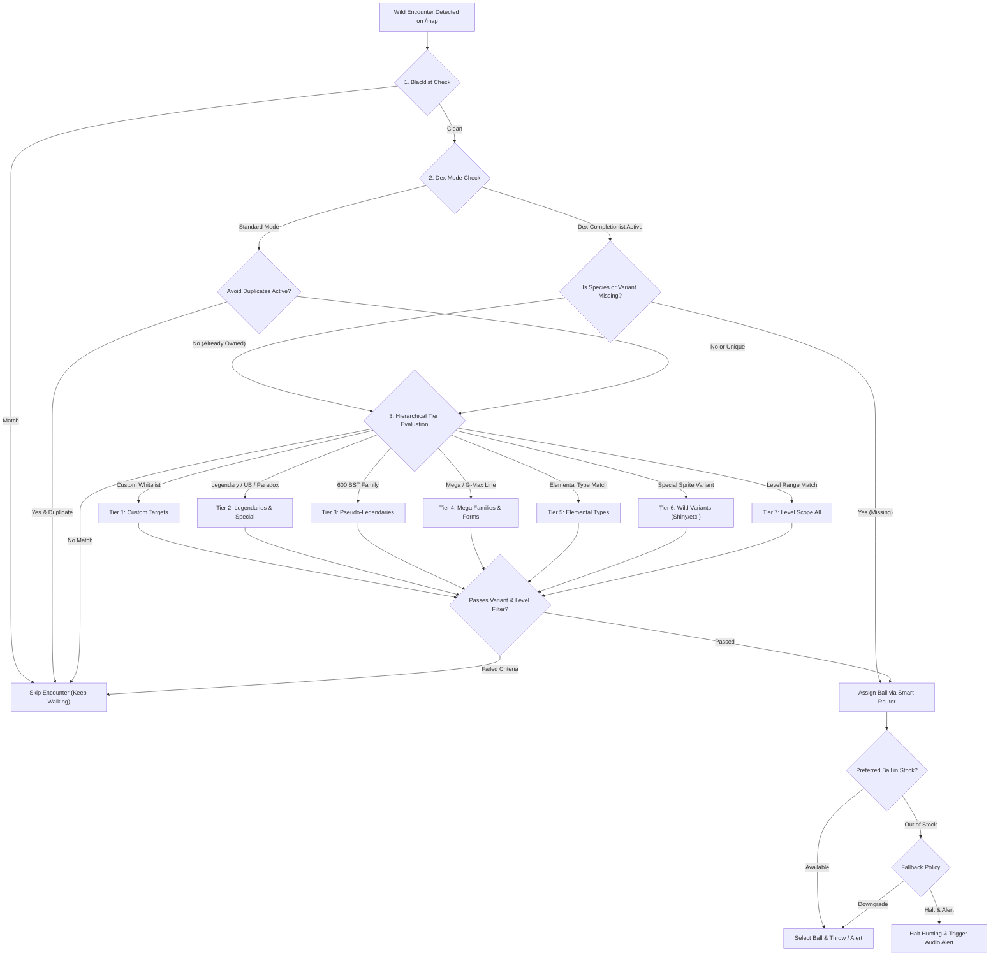

# Implementation Plan: Hardened Target Pokemons Filtering Engine

## 1. Scope & Selected Features

Based on user instructions, this plan covers **Features 1, 3, 4, 5, and 6** with all redundancies eliminated and comprehensive interactive GUI conflict resolution:
* **Feature 1: Elemental Type Targeting (18 Types)** &mdash; Filter wild encounters by elemental affinity with scope control.
* **Feature 3: Dex Completionist Mode** &mdash; Proactively halt and catch any species or variant missing from collection.
* **Feature 4: Pseudo-Legendary & 600 BST Sweepers Tier** &mdash; Dedicated tier for the 10 competitive 3-stage pseudo lines.
* **Feature 5: Smart Ball Priority & Ball Tier Routing** &mdash; Tier-based ball assignment (Master, Ultra, Great, Poke) with fallback rules.
* **Feature 6: User-Defined Named Presets** &mdash; Save, load, and manage named filter configurations in 1 click.

---

## 2. Interactive GUI Mutual Exclusion & Conflict Resolution Matrix

To guarantee a clean, intuitive, and error-free user experience, the GUI enforces dynamic mutual exclusions and interactive state coupling:

| Primary Action / State | Conflicting / Subordinate Control | Interactive UI Enforcement | Rationale / Behavior |
| :--- | :--- | :--- | :--- |
| **Dex Completionist** set to `Missing Species` or `Missing Variants` | `avoidDuplicatesCheck` (Skip Already Caught) | **Auto-Checked & Disabled** (`opacity: 0.5; pointer-events: none;`) with badge `[AUTO-ACTIVE]` | Dex Completionist by definition targets only unowned Pokemon; having duplicate skip toggleable is redundant and confusing. |
| **Dex Completionist** set to `Missing Species Only` | `filterVariantsCheckbox` (Wild Variants Grid) | **Dimmed & Inactive** (`opacity: 0.45; pointer-events: none;`) | If the user only wants new base species, variant hunting on already-owned species must not trigger false positive pauses. |
| **Master Auto-Catch Toggle** is `OFF` (`autoCatchBtn` unchecked) | Entire **Smart Ball Routing Tab** & Controls | **Completely Dimmed & Disabled** (`opacity: 0.4; pointer-events: none;`) with top notice chip `[HUNTING ALERTS ONLY]` | No balls will be thrown during manual hunting, so ball selection controls are inert. |
| Any Target Tier is **Unchecked** (e.g. Pseudo-Legendary unchecked) | Corresponding row in **Smart Ball Routing** | **Row Disabled & Dimmed** (`opacity: 0.4; pointer-events: none;`) | Users cannot configure a ball for an inactive hunting tier. |
| **Enable Elemental Type Filter** is `OFF` | 18 Type Toggle Chips Matrix | **Chips Disabled** (`opacity: 0.35; pointer-events: none; filter: grayscale(1);`) | Prevents accidental type filtering when the user only wants species-tier hunting. |
| **Level Filter Scope** set to `targets` but **Zero Target Tiers Active** | Level Filter Value & Mode inputs | **Inputs Dimmed with Auto-Switch to `all`** | Avoids a "dead" filter state where level checks are applied to an empty target pool. |
| User modifies **any setting** after loading a Preset | Preset Dropdown (`#targetPresetSelect`) | **Switches to `(Custom - Modified)`** and enables `[Save as New...]` button | Protects saved presets from silent accidental overwrites. |
| Active Preset is a **System Preset** (e.g. `Default Legendaries`) | `[Delete Preset]` Button | **Disabled** (`opacity: 0.3; cursor: not-allowed;`) | Prevents deletion of core canonical presets; delete is only enabled for custom user presets. |

---

## 3. Strict Target Precedence & Flow Architecture



---

## 4. Component Implementation Breakdown

### 4.1 Target Definitions ([`desktop-client/targets.js`](file:///d:/PROJECTS_IO/delugeRPG/desktop-client/targets.js))
Add the 10 canonical Pseudo-Legendary families (base, stage 1, final stage):
```javascript
pseudoLegendaries: [
    "Dratini", "Dragonair", "Dragonite",
    "Larvitar", "Pupitar", "Tyranitar",
    "Bagon", "Shelgon", "Salamence",
    "Beldum", "Metang", "Metagross",
    "Gible", "Gabite", "Garchomp",
    "Deino", "Zweilous", "Hydreigon",
    "Goomy", "Sliggoo", "Goodra",
    "Jangmo-o", "Hakamo-o", "Kommo-o",
    "Dreepy", "Drakloak", "Dragapult",
    "Frigibax", "Arctibax", "Baxcalibur"
]
```

### 4.2 Interactive UI Design ([`desktop-client/app.html`](file:///d:/PROJECTS_IO/delugeRPG/desktop-client/app.html))
Maintain strict zero-glow, flat borders, pure ASCII styling within `#targetModal`:
1. **Top Preset Management Toolbar:**
   - Dropdown `<select id="targetPresetSelect">` with presets.
   - Action buttons: `<button id="savePresetBtn">Save</button>` and `<button id="deletePresetBtn">Delete</button>`.
2. **Tab 1: Tiers & Rules:**
   - **Pseudo-Legendaries Tier:** Checkbox `<input id="filterPseudoCheckbox">` + assigned variants badge button.
   - **Elemental Types Matrix:**
     - Master checkbox `<input id="filterTypesCheckbox">` to enable/disable type filtering.
     - Compact 6x3 grid of 18 toggle chips (Normal, Fire, Water, Grass, Electric, Ice, Fighting, Poison, Ground, Flying, Psychic, Bug, Rock, Ghost, Dragon, Steel, Dark, Fairy) with "All" and "None" quick actions.
   - **Collection & Dex Mode Dropdown:**
     - `<select id="dexCompletionMode">`:
       - `standard`: Normal hunting (Enables manual `avoidDuplicatesCheck`).
       - `unowned_species`: Auto-target any missing species (Locks `avoidDuplicatesCheck` to true).
       - `unowned_variants`: Auto-target any missing species OR variant (Locks `avoidDuplicatesCheck` to true).
3. **Tab 4: Smart Ball Routing (New Segmented Tab):**
   - Clean tabular rows assigning preferred ball for each tier:
     - Legendaries / Special: `[Master Ball v]`
     - Pseudo-Legendaries: `[Ultra Ball v]`
     - Mega Lines: `[Ultra Ball v]`
     - Elemental Types: `[Ultra Ball v]`
     - Dex Completionist: `[Ultra Ball v]`
     - Wild Variants: `[Ultra Ball v]`
   - Out-of-stock policy selector: `[Downgrade to Next Ball v]` or `[Halt Hunting & Alert]`.

### 4.3 Interactive GUI Controller & State Synchronizer ([`desktop-client/app.js`](file:///d:/PROJECTS_IO/delugeRPG/desktop-client/app.js))
1. **`syncTargetModalInteractiveStates()` Function:**
   - Called on modal open, preset switch, and any checkbox/select change.
   - Enforces all rules from Section 2 (disabling subordinate rows, dimming inactive ball routing tiers, locking duplicate check when Dex mode is active).
2. **Preset Dirty State Management:**
   - Detects user edits; marks preset dropdown as `(Custom - Modified)` and toggles save/delete button states.
3. **Config Serialization:**
   - Serializes new parameters (`findPseudoLegendaries`, `enableTypeFilter`, `selectedTypes`, `dexCompletionMode`, `ballRouting`) and sends via `delugeView.send('update-config', config.settings)`.

### 4.4 In-Game Preload Engine ([`desktop-client/game-preload.js`](file:///d:/PROJECTS_IO/delugeRPG/desktop-client/game-preload.js))
1. **DOM Type Badge Extractor:**
   - Inspects `#showpoke img` and encounter container for type badges `/types/(\w+)\.png` and `alt="[Type]"`.
2. **Dex Completionist Evaluation:**
   - Uses `evaluateOwnershipAndMegaEquivalence()` to immediately trigger targets if `dexCompletionMode` is active and species/variant is unowned.
3. **Pseudo-Legendary Evaluator:**
   - Matches against `TARGETS.pseudoLegendaries` with designated variant acceptance.
4. **Smart Ball Selector in Auto-Catch Screen 3:**
   - Reads `targetData.preferredBall` from encounter payload or `sessionStorage`.
   - Iterates `radioPool` to select the exact preferred ball radio.
   - If preferred ball stock is 0:
     - If fallback is `downgrade`: walks down (Master -> Ultra -> Great -> Poke) to first available radio.
     - If fallback is `halt`: triggers out-of-stock safety halt and returns to map.

---

## 5. Implementation Phases & Verification Steps

| Phase | Description | Files Modified | Verification Check |
| :---: | :--- | :--- | :--- |
| **Phase 1** | Add Pseudo-Legendaries database & matching logic | [`targets.js`](file:///d:/PROJECTS_IO/delugeRPG/desktop-client/targets.js), [`game-preload.js`](file:///d:/PROJECTS_IO/delugeRPG/desktop-client/game-preload.js) | Test match on Dratini, Dragapult, Baxcalibur |
| **Phase 2** | Implement 18 Elemental Types DOM extractor & filter | [`game-preload.js`](file:///d:/PROJECTS_IO/delugeRPG/desktop-client/game-preload.js), [`app.html`](file:///d:/PROJECTS_IO/delugeRPG/desktop-client/app.html), [`app.js`](file:///d:/PROJECTS_IO/delugeRPG/desktop-client/app.js) | Test type badge scraping on Water/Dragon encounters |
| **Phase 3** | Integrate Dex Completionist mode with collection engine | [`game-preload.js`](file:///d:/PROJECTS_IO/delugeRPG/desktop-client/game-preload.js), [`app.js`](file:///d:/PROJECTS_IO/delugeRPG/desktop-client/app.js) | Test trigger on unowned common species & unique variants |
| **Phase 4** | Implement Smart Ball Tier Routing & fallback logic | [`game-preload.js`](file:///d:/PROJECTS_IO/delugeRPG/desktop-client/game-preload.js), [`app.html`](file:///d:/PROJECTS_IO/delugeRPG/desktop-client/app.html), [`app.js`](file:///d:/PROJECTS_IO/delugeRPG/desktop-client/app.js) | Verify Ultra Ball selection on Shinies vs Master Ball on Legendaries |
| **Phase 5** | Build Named Presets Manager UI & interactive GUI sync | [`app.html`](file:///d:/PROJECTS_IO/delugeRPG/desktop-client/app.html), [`app.js`](file:///d:/PROJECTS_IO/delugeRPG/desktop-client/app.js) | Verify mutual exclusions, dimming states, preset save/load |
| **Phase 6** | Deep Verification & 7-Bit ASCII Audit | All modified files | Run `node test_deep_verification.js` (115/115 pass) |

---

## 6. Verification Gate & Safety Commitments
* **Zero Glowing Shadows:** Flat styling preserved (`box-shadow: none !important;`).
* **Zero Unnecessary Text Information Lines:** Strictly functional UI controls without filler descriptions.
* **100% 7-Bit Clean ASCII Integrity:** All characters <= 127 strictly enforced.
* **Non-Blocking Docked Layout:** `#targetModal` remains docked at 25% width without interfering with webview gameplay.
* **115/115 Verification Suite:** All pipelines must pass before completion.
---

## 7. Conservative Code Modification Policy & Untouchable Feature Isolation

To strictly prevent collateral regressions, side effects, or destruction of existing functionality, all future implementation work MUST follow this ultra-conservative surgical boundary protocol:

### 7.1 Strict Allowed Touch Boundaries (Confined Zones Only)
Modifications are strictly quarantined to the Target Pokemons feature surface:
1. **Target Definitions:** `desktop-client/targets.js` (Only adding `pseudoLegendaries` array).
2. **Target Modal DOM:** `desktop-client/app.html` (Only within `#targetModal` markup between line ~2275 and ~2497).
3. **Target Host Controller:** `desktop-client/app.js` (Only within target filter event listeners, `updateTargetUI`, `saveTargetsBtn`, and the new `syncTargetModalInteractiveStates` helper).
4. **Preload Scanner Branches:** `desktop-client/game-preload.js` (Only within the internal evaluation branches of `scanForTargets` and the ball radio selection loop in Screen 3 of `autoCatch`).

### 7.2 Explicit Non-Touch Zones (STRICTLY PROHIBITED TO MODIFY)
The following subsystems are completely unrelated to target filtering and MUST NEVER be touched, edited, refactored, or rearranged:
* **Movement & Map Engine:** `startWalking`, `stopHuntingWithReason`, `handleMoveSuccess`, `walkTimeout`, `stepCount`, `turnDelay`, `jitter`, `randomJitterDelay`.
* **Anti-Ban Safety Limits Engine:** `sessionAutoStopTimer`, `dailyCatchCeiling`, `microBreaks`, `idlePauses`, `rerollSafetyTargets`, `daily_safety_log.json`.
* **Live AI Combat Assistant & HUD:** `updateLiveAiAssistantUI`, `executeAiBattleAction`, `updateTeamBuilderBattleAction`, floating HUD telemetry, `ml_combat_engine.py`, `team_engine.js`.
* **Gym Leaders & Opponents Database:** `gym_leaders.json`, `renderTeamLineup`, canonical 6-Pokemon champion rosters, `scoutOpponent`, `favorite_trainers.json`.
* **Ad Inspector & Cosmetic Hider:** `#adsInspectorModal`, `adsBlockedCount`, ad mutation observers.
* **Network & Proxy Settings:** `#networkModal`, proxy validation, `refreshIpBtn`.
* **Evolution Engine & Box Moves:** `evolution_engine.js`, `skills_database.json`, evolution readiness scanners.

### 7.3 Surgical Implementation Rules
* **Additive Only:** Add targeted helper functions rather than rewriting existing control flows.
* **Preserve Contracts:** Never alter existing IPC message signatures (`update-config`, `target-found`, `autocatch-status`). All new config properties must have safe fallbacks.
* **Zero Blind Reads/Edits:** Always run locate scripts before viewing, and verify exact line ranges.
* **Per-Phase Regression Gate:** Run `node test_deep_verification.js` immediately after each phase. If any of the 115 tests fails, execution stops immediately until resolved.
